# 🎮 ESFOT RPG: La Batalla de los Reinos

Tarea integradora — Programación Orientada a Objetos (Java)  
**Modalidad:** Individual

---

## 📖 Descripción del Proyecto
Aplicación desarrollada por consola en Java que simula un juego de rol (RPG). Permite la gestión y creación de diferentes tipos de personajes héroes aplicándose los pilares fundamentales de la Programación Orientada a Objetos: **Herencia** (simple, jerárquica y multinivel), **Encapsulamiento**, **Polimorfismo**, **Sobrecarga**, **Sobrescritura** y el uso de **Colecciones** (`List` y `Map`).

---

## 🚀 Instrucciones de Ejecución
1. Abre el proyecto en **IntelliJ IDEA**.
2. Asegúrate de que las clases estén organizadas en sus respectivos paquetes (`personajes` y `juego`), y el archivo `Main.java` en la raíz de `src`.
3. Ejecuta la clase `Main.java`.
4. Utiliza el menú interactivo por consola (opciones del 1 al 11) para crear personajes, realizar ataques, usar habilidades especiales y simular combates.

---

## 🧬 Diagrama de Clases (UML)
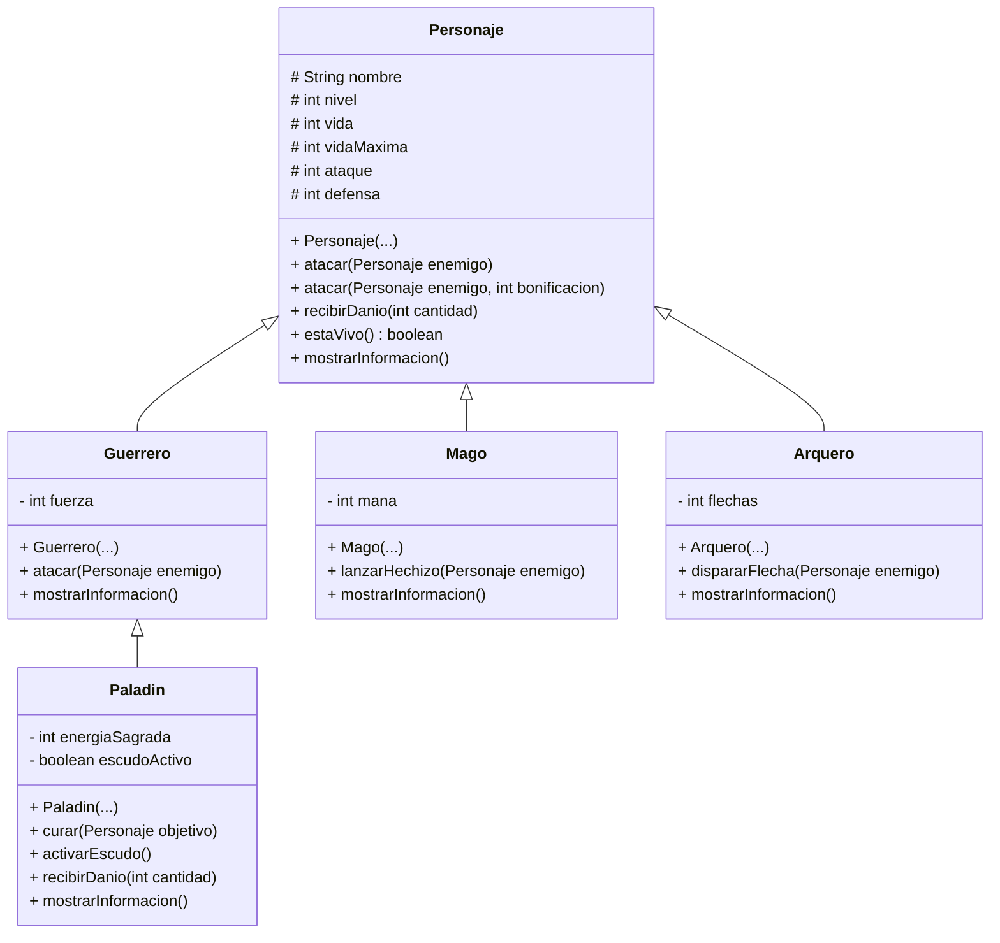
Estructura del Proyecto
- `personajes/`: Contiene la clase padre `Personaje` y las subclases (`Guerrero`, `Mago`, `Arquero`, `Paladin`).
- `juego/`: Contiene la clase `GestorJuego` para administrar el registro mediante `List` y `Map`, además de la lógica de combate.
- `Main.java`: Menú interactivo por consola.

            PREGUNTAS DE ANALISIS
1. **¿Donde se aplica herencia simple en el proyecto?**

Herencia simple se aplica en la relacion donde 'Guerrero extends Personaje',
'Mago extends Personaje' y 'Arquero extends Personaje' heredan directamente de la clase padre.

2. **¿Por qué Personaje → Guerrero → Paladinrepresenta herencia multinivel?**

Porque 'Paladin ' hereda de 'Guerrero ' y a su vez 'Guerrero' hereda de 'Personaje',formando una cadena de herencia de tres niveles.
3. **¿Qué relación ejemplifica herencia jerárquica?**

Cuando multiples clases('Guerrero', 'Mago' y 'Arquero') hereden caracteristicas de una misma clase padre('Personaje').

**4. 'Cual es la diferencia entre sobreescritura y sobrecarga de atacar()?'**

La sobrescritura de metodos @Override cambia el comportamiento del metodo atacar('Personaje') en una clase hija (como en 'Guerrero').

La sobrecarga consiste en tener multiples metodos con el mismo nombre ('atacar') pero con diferentes parametros(uno con bonificacion y otro sin bonificacion).

**5. ¿Qué aporta superen constructores y métodos?**

Permite invocar el constructor de la clase padre para inicializar los atributos heredados y reutilizar metodos del padre como ('super.recibirDanio(...')).

**6. ¿Porque List<Personaje> admite guerreros, magos, arqueros y paladines?**

Gracias al polimorfismo cualquier objeto de una subclase puede ser tratado como una referencia de su superclase (Personaje).

**7. ¿Qué versión de mostrarInformacion()se ejecuta al recorrer la lista y por qué?**

Se ejecuta la version especifica de cada clase hija gracias al polimorfismo en tiempo de ejecucion.

**8. ¿Cuándo se necesita instanceof antes de hacer casting?**

Se utiliza para verificar de que tipo es realmente un objeto almacenado en una referencia generica ('Personaje') antes de transformarlo ('Mago') para usar sus metodos particulares.

**9. ¿Qué ventaja aporta HashMap para localizar un personaje por nombre?**

Pemite busquedas directas y eficientes por clave ('0(1)') utilizando el nombre como clave y el objeto como valor.

**10. ¿Como se protege la consistencia de los atributos mediante encapsulamiento?**

Declarando los atributos como privados o protegerlos y controlando su acceso mediante metodos constuctores y validaciones.

#          **Capturas de pantalla que demuestran creación, búsqueda, habilidades y un combate completo.**

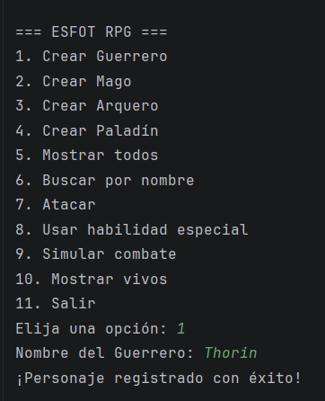
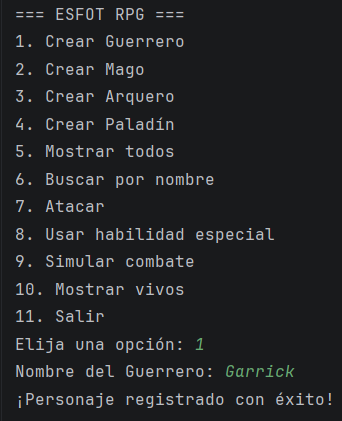
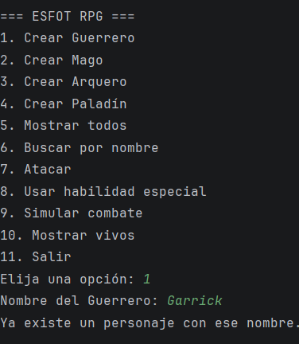
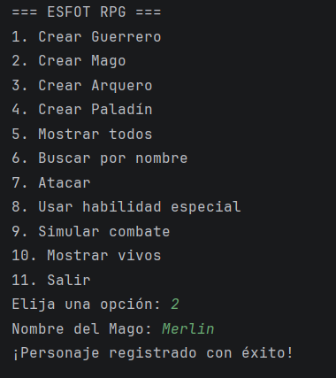
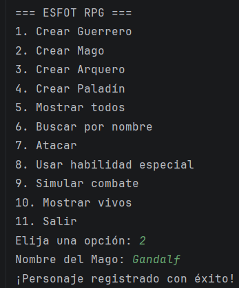
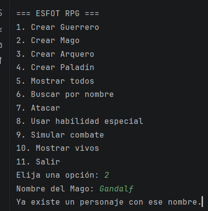
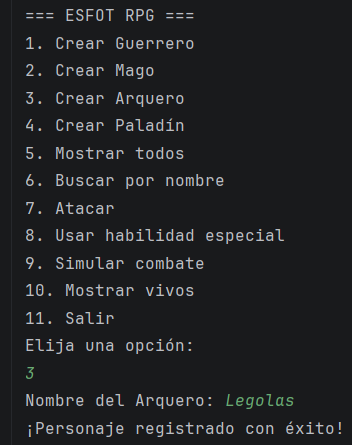

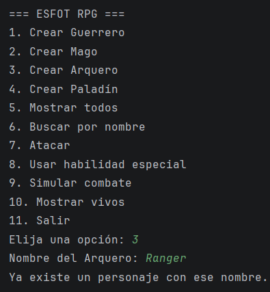
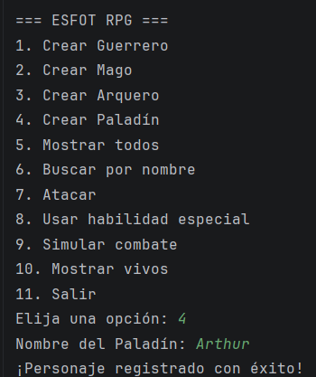
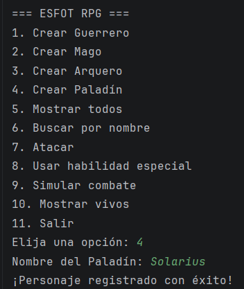
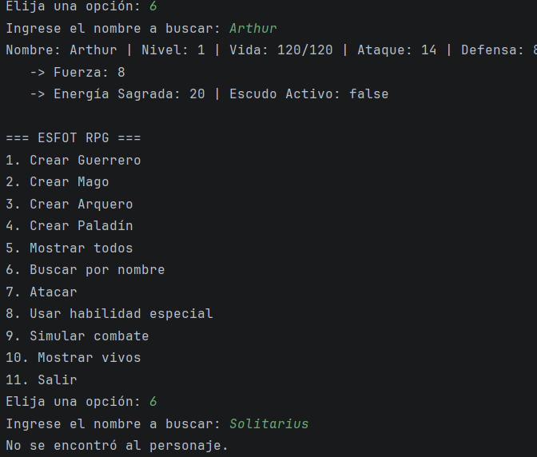
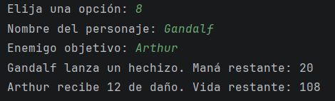
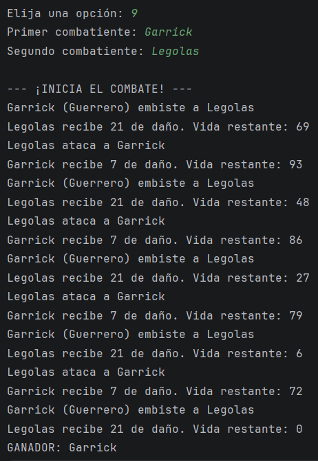

